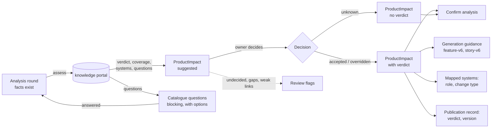

# Ontology plan Phase 4 — Product verdict in requirement analysis

## Objective

Decide, once and early, whether a requirement changes an existing product or needs a new one,
and let the breakdown, the review and the publication follow that decision (ADR-0115,
ADR-0116). Phase 4 of the ontology and impact plan
([plan](https://claude.ai/code/artifact/27b1b1d1-b01b-40d4-9264-1999bc29b2bf)), on
knowledge-portal's `POST /internal/architecture/assess` from Phase 3 (knowledge-portal v0.3.0).

## User Outcome

A Requirement Owner sees, before confirming the analysis, where the requirement sits in the
portfolio: the suggested verdict, the offering, which needed capabilities the offering already
covers, the gaps, and the systems with their role, change type, path and owners. They accept the
suggestion, choose another verdict with a reason, or mark it unknown. When the catalogue cannot
place the requirement, it asks, with the answers it knows as choices.

## In Scope

- Calling assess after each analysis round's facts exist, and storing the result on the analysis.
- Catalogue questions as blocking clarification questions with options; answering one re-runs
  assess.
- The owner's decision, and the confirmation gate on it.
- Review flags, the review fingerprint, generation guidance (`feature-v6`, `story-v6`), the role
  and change type on mapped systems, and the verdict on the publication record.
- The vendored knowledge contract moved to knowledge-portal v0.3.0.

## Out of Scope

- Analysis that reads the catalogue's vocabularies and concepts itself (Phase 5).
- The Epic-closed hook comparing what was delivered with the verdict (Phase 7).
- Caching assess by analysis revision: each round asks once, and rounds are already model calls.

## Domain



`ProductImpact` (`analysis/domain/product_impact.py`) is a value on `RequirementAnalysis`, with
`product_impact_status`: `assessed`, `not_connected` or `unavailable`.

| Field | Example |
|---|---|
| `release_id` | `rel-2026-10` |
| `suggested_verdict` | `change_existing_offering` |
| `reason` | "Business Fiber already covers static IPs; the requirement adds a quota." |
| `offering_id`, `offering_name` | `offering:business-fiber`, Business Fiber |
| `needs` | Static IP (covered), Usage quota (not covered, weak) |
| `gaps` | capability · Usage quota · "No system realises it." |
| `systems` | BCRM · role `primary` · change `modify` · path Need › Static IP › Business Fiber › BCRM |
| `owners` | BCRM: Sales squad, Mona Adel, 1 open seat |
| `decision`, `verdict` | `accepted`, `change_existing_offering` |

Invariants: an accepted verdict is the suggested one; an override chooses another verdict and
gives a reason; unknown has no verdict; the decision, its author and its time go together. A new
round keeps the decision while its suggested verdict and offering are unchanged.

## Application Use Cases

- `AssessProductImpact.augment` runs after the analyzer, in both a new analysis and question
  resolution. Not linked → `not_connected`; unreachable or refused → `unavailable` (the previous
  impact and decision are kept); a knowledge portal older than v0.3.0 (404) → `not_connected`.
- `reconcile_round` reconciles catalogue questions on their own: kept while asked again, retired
  when not, untouched while the portal is unavailable, and never a duplicate of an AI or human
  question's subject.
- `AnalysisCollaboration.decide_product_impact` records the owner's decision (owner only,
  versioned like other analysis decisions, refused once confirmed).
- `RequirementAnalysis.confirm` refuses while a product impact awaits a decision.
- `GenerationChecks.guidance` passes the decided impact instead of a fresh match; without a
  verdict it matches as before.
- `MapFeatureArchitecture` and `MapStoryArchitecture` mark each system the decided impact names
  with its role and change type.
- `PublishBreakdown` writes the decided verdict and `analysis-id@version` to the publication
  record.

## Ports

- `ArchitectureAssessmentPort` (`references/application/ports/architecture_assessment.py`):
  `is_connected()` and `assess(query)`. Role, path kind and facet kind are text, so values the
  knowledge portal adds later are shown as written.
- `ProductImpactPort` (`analysis/application/ports/product_impact.py`).

## Adapters

- `HttpArchitectureAssessment` posts to `/internal/architecture/assess` with its own 120-second
  timeout and the shared breaker; `FakeArchitectureAssessment` is the offline stand-in.
- The analysis snapshot stores the impact; the backlog codecs store a system's role and change
  type only when set. Generation context tokens and review fingerprints are unchanged for
  analyses and systems without them.

## API

`PUT /requirements/{id}/analysis/product-impact/decision`

```json
{"decision": "overridden", "verdict": "new_plan",
 "rationale": "It is sold as a separate plan.", "expected_version": 7}
```

Answers the analysis. `RequirementAnalysisResponse` gains `product_impact_status` and
`product_impact` (with `verdict_validated`); a question gains `options`; a mapped system gains
`role` and `change_type`. Errors: `product_impact_not_found` (404),
`invalid_product_impact_decision` (422), `product_impact_decision_locked` (409).

## UI

- **Product impact card** in analysis (`features/analysis/ProductImpactCard.tsx`). Undecided, it
  sits with the open decisions, before the confirmation gate; decided, it moves to the settled
  column beside the agreed outcome. It shows the verdict (labelled a suggestion until validated),
  offering, coverage, capabilities, gaps, systems with role, change and path, owners, and Accept
  the suggestion, Choose another verdict (verdict and reason) and Mark as unknown.
- **The gate** names an undecided product impact as the reason confirmation is blocked.
- **Catalogue answers** appear under a catalogue question's answer box; picking one fills it.
- **Architecture impact panel**: Role and Change rows on each system the decided impact names.

## Business Rules

- With no knowledge portal linked, nothing is assessed and nothing is blocked (ADR-0104).
- An undecided impact blocks confirmation; "unknown" is always an allowed decision.
- No verdict is suggested while catalogue questions are open.
- Generation never names a system the decided impact does not list, turns gaps into spikes, and
  includes set-up work for a new plan, offering or product line (ADR-0116).
- Review flags are warnings with a decision to resolve: verdict not decided, each capability gap,
  each weak concept link.
- A decided impact joins the review fingerprint; an undecided one leaves it unchanged. The
  review ruleset version stays `breakdown-review-v3`.

## Tests

- `tests/unit/analysis/test_product_impact.py`: the analysis lifecycle with a stub assessment,
  catalogue questions and their options, answering one re-assesses, blocked confirmation,
  accept, override and unknown with their errors, no knowledge portal, an unreachable portal, a
  decision kept or asked again, the locked decision, the mapping and the domain invariants.
- `tests/unit/test_product_impact_downstream.py`: review flags and fingerprint, generation
  guidance and its prompt block, role and change type on mapped systems and their codec, the
  publication record filled by a real publish, and the setting.
- `tests/unit/test_knowledge_http_contract.py`: assess as the contract describes, values added
  later, a 404 as "not offered", an unusable answer.
- `frontend/src/features/analysis/ProductImpactCard.test.tsx` and
  `frontend/src/features/architecture/ArchitectureImpactPanel.test.tsx`.
- The characterisation goldens are unchanged.

## Acceptance Criteria

- [x] With the knowledge portal connected, a requirement cannot be confirmed with an undecided
  verdict.
- [x] Breakdown uses the stored verdict, not a fresh match.
- [x] Without a knowledge portal, analysis and confirmation behave as before.
- [x] The accepted verdict and its version fill the publication record.

## Validation Evidence

Run on 2026-10-10 against this branch:

- `pytest` — PASS locally without PostgreSQL; the integration tests run in CI
- `ruff check .`, `ruff format --check .`, `mypy src tests`, `lint-imports` — PASS
- `cd frontend && npm run lint && npx vitest run && npm run build && npm run api:check` — PASS

## Deferred

- The live verdict gate run (80% on knowledge-portal's golden set); set
  `PRODUCT_VERDICT_VALIDATED=true` once it passes.
- Caching assess by analysis revision.
