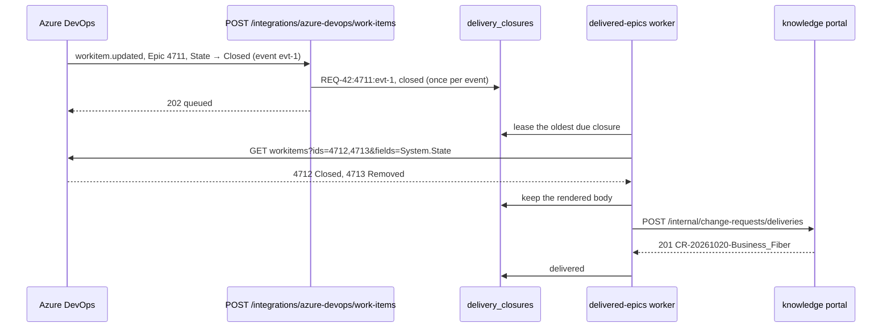

# Ontology plan Phase 7 — What a closed Epic delivered

## Objective

Close the loop between the prediction and the delivery. When an Epic this service published
is closed or removed in Azure DevOps, the tracker's service hook tells this service. It reads
the Epic's Features' states, compares what was delivered with the decided product impact, and
sends that, with the catalogue changes it implies, to knowledge-portal's
`POST /internal/change-requests/deliveries`. There a knowledge admin reads it as a catalogue
change, and the portal's front page counts how often the predicted systems were the ones
delivered.

Phase 7 of the ontology and impact plan
([plan](https://claude.ai/code/artifact/27b1b1d1-b01b-40d4-9264-1999bc29b2bf)). The receiving
side is knowledge-portal v0.5.0 (its slice `docs/slices/ontology-phase-7-delivery-closure.md`).
This service stays the only one that talks to the tracker, and it only reads from it.

## User Outcome

Nothing changes on a requirement's screens. When Epic 4711, "Static IP quota", is closed with
one of its two Features done, the knowledge admin finds "Epic closed: 1 delivered Feature for
Business Fiber" in the knowledge portal's inbox. It suggests "BCRM realises Static IP" and asks
Business Fiber which component now delivers it, and says "Delivered 1 of the 2 systems
predicted (CIM was not)". If the Epic is removed instead, a closure still waiting there is
withdrawn.

## In Scope

- A public route for the tracker's service hook, `POST /integrations/azure-devops/work-items`,
  signed with Basic auth and `ADO_HOOK_SECRET`.
- An outbox of closures, one per tracker event (`delivery_closures`), and a worker that renders
  each once and delivers it, retried until the service answers.
- Reading the Features' `System.State` in one batch call to Azure DevOps.
- The catalogue-change rules below.
- The vendored knowledge contract and the CI pin moved to knowledge-portal v0.5.0.

## Out of Scope

- Writing anything to the tracker.
- Epics closed before this release: there is no backfill.
- Drafting a new offering from a delivery (Phase 9).
- Features or Stories closed on their own: only the Epic's event is read.

## Domain



A `DeliveryClosure` (`references/application/ports/delivery_closure.py`) is keyed by the
Requirement, the Epic and the tracker's event (`REQ-42:4711:evt-1`), which is also the
delivery id the knowledge portal keeps it by. The hook finds the Requirement through its
publication record: the record whose mappings hold an Epic with that tracker id
(`find_by_work_item`, a GIN index on the mappings).

| Tracker state, case aside | Epic outcome | Sent |
|---|---|---|
| Closed (Agile, CMMI), Done (Scrum) | closed | what was delivered, if a Feature is done |
| Removed | removed | the Epic only; a waiting closure is withdrawn |
| anything else | — | nothing; the hook answers `ignored` |

A Feature is delivered when its own state is Closed or Done. Its systems are the ones its
architecture mapping and its Stories' mappings name: by id when the catalogue has them, by name
when it does not.

### The catalogue changes

For each capability the decided product impact needed and the catalogue did not cover (a weak
link is a guess, so it is left out):

| Change | When | Read there as |
|---|---|---|
| `realise_concept` | a delivered system the assessment reached through that capability (a path step `concept`), or else the system its capability gap names | a capability on that system, linked to the concept |
| `offer_concept` | the verdict changes an existing offering or adds a plan to it | a question on the offering: which component now delivers it |

With no delivered system tied to the capability, the offering is asked only when every Feature
was delivered: part of the Epic was dropped, and nothing says the capability shipped.

An example, as sent for Epic 4711:

```json
{
  "delivery_id": "REQ-42:4711:evt-1",
  "state": "closed",
  "requirement_id": "REQ-42",
  "breakdown_revision": 3,
  "approval_id": "APR-9",
  "epic": {"id": "EP-1", "name": "Static IP quota", "external_id": "4711",
           "url": "https://dev.azure.com/acme/SMB/_workitems/edit/4711"},
  "occurred_at": "2026-10-20T15:30:00+00:00",
  "release_id": "rel-2026-10",
  "impact_version": "ANA-1@7",
  "decision": "accepted",
  "suggested_verdict": "change_existing_offering",
  "verdict": "change_existing_offering",
  "offering_id": "offering:business-fiber",
  "offering_name": "Business Fiber",
  "predicted_systems": [
    {"id": "bcrm", "name": "BCRM", "role": "primary", "change_type": "modify"},
    {"id": "cim", "name": "CIM", "role": "supporting", "change_type": "configure"}
  ],
  "features": [
    {"id": "FT-1", "sequence": 1, "name": "Order a static IP", "outcome": "Customers order one.",
     "external_id": "4712", "state": "Closed", "delivered": true,
     "systems": [{"id": "bcrm", "name": "BCRM"}]},
    {"id": "FT-2", "sequence": 2, "name": "Show the IP on the bill", "outcome": null,
     "external_id": "4713", "state": "Removed", "delivered": false,
     "systems": [{"id": "cim", "name": "CIM"}]}
  ],
  "changes": [
    {"op": "realise_concept", "concept_id": "cap:static-ip", "concept_label": "Static IP",
     "system_id": "bcrm", "system_name": "BCRM", "feature_ids": ["FT-1"]},
    {"op": "offer_concept", "concept_id": "cap:static-ip", "concept_label": "Static IP",
     "offering_id": "offering:business-fiber", "offering_name": "Business Fiber",
     "feature_ids": ["FT-1"]}
  ]
}
```

## Application Use Cases

- `RecordTrackerEvent.execute(event)` (behind the hook): an Epic closed or removed that this
  service published is queued once; anything else returns nothing.
- `DeliverClosures.deliver_next` leases one due closure for five minutes. The first time, it
  renders the body and keeps it, so every retry sends the same one. It skips, with the reason
  kept on the row, a Requirement with no published revision, an Epic published to another
  project than the one set up now, a revision no longer exportable, no decided product impact,
  and a closure with no Feature done. A tracker that does not answer, or a knowledge service that
  answers 404, 429, 5xx or not at all, is retried after 1 minute, doubling to an hour, and given
  up after 48 attempts (about two days). Refused as it is (400, 409, 413, 422): failed.
- `delivery_body` and its rules are pure functions of the publication record, the approved
  revision's export, the product impact and the Features' states.

## API

| Route | Who | Answer |
|---|---|---|
| `POST /integrations/azure-devops/work-items` | Azure DevOps, Basic auth with `ADO_HOOK_SECRET` | 202 `{"status": "queued", "closure_id": …}` or `{"status": "ignored"}`; 401 a wrong secret; 404 when the secret or the knowledge portal is not set; 422 a body that is not a work-item event |

The body is read leniently: only `id`, `eventType`, `createdDate`, `resource.workItemId` and
`resource.fields["System.State"].newValue`. Every admitted event answers 202, so the tracker
does not keep retrying one this service has nothing to do with.

## Ports and Adapters

- `DeliveryClosureOutboxPort` (`enqueue`, `get`, `claim`, `save`) and `DeliveryInboxPort`
  (`deliver(body) -> DeliveryReceipt`); `InMemoryDeliveryClosures` and
  `PostgresDeliveryClosures` (`FOR UPDATE SKIP LOCKED`, a stale write refused by version).
- `PublicationRepositoryPort.find_by_work_item(kind, external_id)`.
- `BacklogPublisherPort.states(external_ids)`: Azure DevOps reads 200 ids a call with
  `errorPolicy=omit`, so a deleted Feature is left out rather than failing the rest; the fake
  publisher answers "New" until a test sets a state.
- `HttpDeliveryInbox` posts to `/internal/change-requests/deliveries` (idempotent, so the shared
  client retries it) and reads the receipt.
- The `delivery_worker` background worker ("delivered-epics"), metrics job `delivery_closure`.
  It exists only with a remote knowledge service; the hook only with `ADO_HOOK_SECRET` too.

## Migration

`202610111800_delivery_closures` (expand only: a new table, and a GIN index on the publication
records' mappings).

## Configuration

`ADO_HOOK_SECRET` or `ADO_HOOK_SECRET_FILE`, 24 or more characters. Setting up the
subscription in Azure DevOps is in `docs/operations/deployment.md`, "Azure DevOps service
hook".

## Business Rules

- This service only reads from the tracker; the knowledge portal never reads it at all.
- A closure is sent only for an Epic this service published, with a decided product impact and
  at least one Feature closed as done.
- A removal is always sent, so a closure still waiting in the knowledge portal is withdrawn.
- The same event delivered twice is queued once; each later event is its own closure, and the
  knowledge portal keeps the latest for the Epic.

## Tests

- `tests/unit/governance/test_delivery_closure.py`: the hook (queued once per event, every
  other event ignored, the secret, 404 without it); the worker against a published Requirement
  (the body the pinned contract allows, a skip with no Feature done, a removal, one rendering for
  every retry, a tracker that does not answer); the change rules (a delivered system on the
  path, a covered need, a gap's system, partial delivery, a new offering, an uncatalogued
  system); retries, refusals and giving up.
- `tests/integration/test_delivery_closures_postgres.py` and
  `tests/integration/test_publication_records_postgres.py`: one row per event, leased to one
  worker, the kept body; a record found by its Epic.
- `tests/unit/test_knowledge_http_contract.py`: a closure and a removal as the contract
  describes them, a refused or unusable receipt.
- `tests/unit/governance/test_azure_devops_publisher.py`: the state read, batches, refusals.
- `tests/unit/test_ado_publication_settings.py`: the secret, from a value or a file, and its
  length.
- `tests/architecture/test_route_authentication.py`: the hook is the one new public route.

## Acceptance Criteria

- [x] A closed Epic this service published reaches the knowledge portal once, with what it
  delivered and what was predicted.
- [x] A removed Epic withdraws its waiting closure there.
- [x] A wrong or missing secret queues nothing; without the secret the route is not there.
- [x] The tracker and the knowledge portal being down delays a closure, and loses none.

## Validation Evidence

Run on 2026-10-11 against this branch:

- `pytest` with PostgreSQL 16: 2241 passed, none skipped
- `ruff check .`, `ruff format --check .`, `mypy src tests`, `lint-imports`: pass
- frontend `typecheck`, `api:check` and `build`: pass (the hook joins the OpenAPI document)
