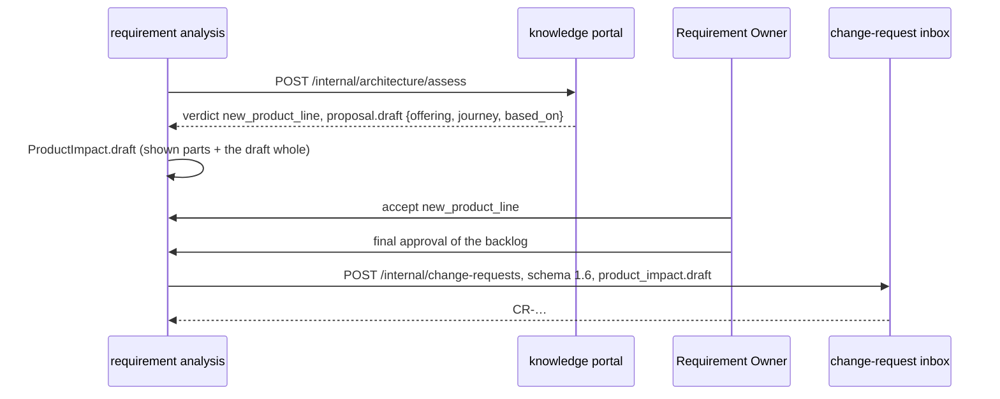

# Ontology plan Phase 9 — A drafted offering for a new offering

## Objective

When the knowledge portal places a requirement as a new offering, it now drafts what the
catalogue would hold for it: an offering and the journey that fulfils it, from the nearest
offering, by fixed rules. This service keeps the draft on the round's product impact, shows it
on the product impact card, and sends it back with the approved backlog, where the knowledge
portal's curators edit and accept it as suggestions.

Phase 9 of the ontology and impact plan
([plan](https://claude.ai/code/artifact/27b1b1d1-b01b-40d4-9264-1999bc29b2bf)). The drafting
side is knowledge-portal v0.6.0 (its slice `docs/slices/ontology-phase-9-new-offering-drafts.md`).
The draft is a proposal for the catalogue, never a decision here: nothing in breakdown,
review or publication reads it.

## User Outcome

- **Requirement Owner, analysis.** "Cloud video surveillance for shops" is suggested as a new
  product line. Under the verdict, the product impact card says "The knowledge portal drafted
  **Cloud video surveillance for shops** from Business Fiber. If the verdict stays a new
  offering, it goes to the catalogue's curators with the approved backlog." It lists the
  components (Managed access point by ECM, WFMS; Cloud video surveillance with "No system
  yet"), "Its journey, Fulfilment, has 2 steps.", and "For architecture review: Which system
  will realise Cloud video surveillance?". Once decided, it says the draft is sent, or, when
  the decided verdict is not a new offering, that it is not.
- **Knowledge admin.** The approved backlog's change request carries the draft; reading it
  suggests the offering and the journey first.

## In Scope

- `AssessedProposal.draft` from `POST /internal/architecture/assess`: the parts this service
  shows, and the draft whole as the knowledge portal wrote it.
- `ProductImpact.draft`, kept in the analysis snapshot.
- `ProductImpactResponse.draft` and the card's "Drafted offering" section.
- Export schema 1.6: the decided product impact on the approved backlog, with the draft.
- The vendored knowledge contract and the CI pin moved to knowledge-portal v0.6.0.

## Out of Scope

- Editing the draft here: the knowledge portal's curators do, where the catalogue is kept.
- Using the draft in generation, review or publication.

## Domain



`OfferingDraft` (`analysis/domain/product_impact.py`) holds the offering's id and name, each
component's name and the systems that would deliver it, the questions left for architecture
review, the journey's name and step count, the offering it was drafted from, and `document`,
the draft as the knowledge portal wrote it.

`ProductImpact.decided_draft` is the draft only while the decided verdict is a new offering:

| Decided verdict | Sent with the approved backlog |
|---|---|
| New offering in an existing family, new product line (accepted or overridden to) | `product_impact` with the draft |
| Change to an existing offering, new plan | `product_impact`, `draft: null` |
| Unknown, or no decided impact | `product_impact: null` |

A new round asks again, so its draft replaces the earlier one; a decision carried over to it
keeps the new draft.

## Export schema 1.6

One additive field at the top of the approved-backlog export, the JSON download included:

```json
"product_impact": {
  "verdict": "new_product_line",
  "offering_id": "offering:business-fiber",
  "release_id": "rel-2026-10",
  "draft": {
    "offering": {"id": "cloud-video-surveillance-for-shops",
                 "name": "Cloud video surveillance for shops", "lifecycle": "Proposed",
                 "components": [ … ], "questions": [ … ], … },
    "journey": {"id": "cloud-video-surveillance-for-shops-journey", "name": "Fulfilment",
                "product_id": "cloud-video-surveillance-for-shops", "activities": [ … ]},
    "based_on": "offering:business-fiber"
  }
}
```

`offering_id` is the offering in question: the one the requirement changes, or the nearest one
to a new offering. A knowledge portal older than v0.6.0 ignores the field. The spreadsheet
download is unchanged.

## API

| Route | Change |
|---|---|
| `GET /requirements/{id}/analysis` | `product_impact.draft`: `{offering_id, offering_name, based_on, components: [{name, system_ids}], questions, journey_name, journey_steps}` or `null` |
| `GET /requirements/{id}/revisions/{n}/export?format=json` | `schema_version` 1.6 and `product_impact` |

## UI

The product impact card adds a "Drafted offering" section under the verdict, before the
capabilities: the drafted name and where it came from, where it goes given the decision so
far, its components with the systems that would deliver them ("by ECM, WFMS", or a "No system yet" badge), its
journey's size, and each question for architecture review. System ids are named from the
impact's systems.

## Migration

None: the draft is stored in the analysis snapshot, and a stored impact without one reads as
none.

## Tests

- `tests/unit/analysis/test_product_impact.py`: the draft maps into what is shown and stays
  whole through the stored snapshot; it is sent only while the decided verdict is a new
  offering; an approved backlog's export carries it exactly as assessed, and a change to an
  offering is exported without one.
- `tests/unit/test_knowledge_http_contract.py`: a drafted assessment decoded as the pinned
  contract describes, the draft kept as written; `product_impact` as the contract's
  `ApprovedBacklogRequest` allows it.
- `tests/unit/governance/test_backlog_export.py`: the export's top-level fields and version.
- `frontend/src/features/analysis/ProductImpactCard.test.tsx`: the section, before and after a
  decision.

## Acceptance Criteria

- [x] A new-offering verdict's draft is kept with the analysis and shown on the card.
- [x] The approved backlog sends it back unchanged while the decided verdict is a new
  offering, and not otherwise.

## Validation Evidence

Run on 2026-10-11 against this branch:

- `pytest` with PostgreSQL 16: 2247 passed, none skipped
- `ruff check .`, `ruff format --check .`, `mypy src tests`, `lint-imports`: pass
- frontend `typecheck`, `lint`, `test` (575 passed), `build`, `api:check`: pass
- The card, rendered with the app's styles at desktop and phone widths, before a decision: the
  components' systems read as a bare list beside the name, so they now say "by ECM, WFMS".
